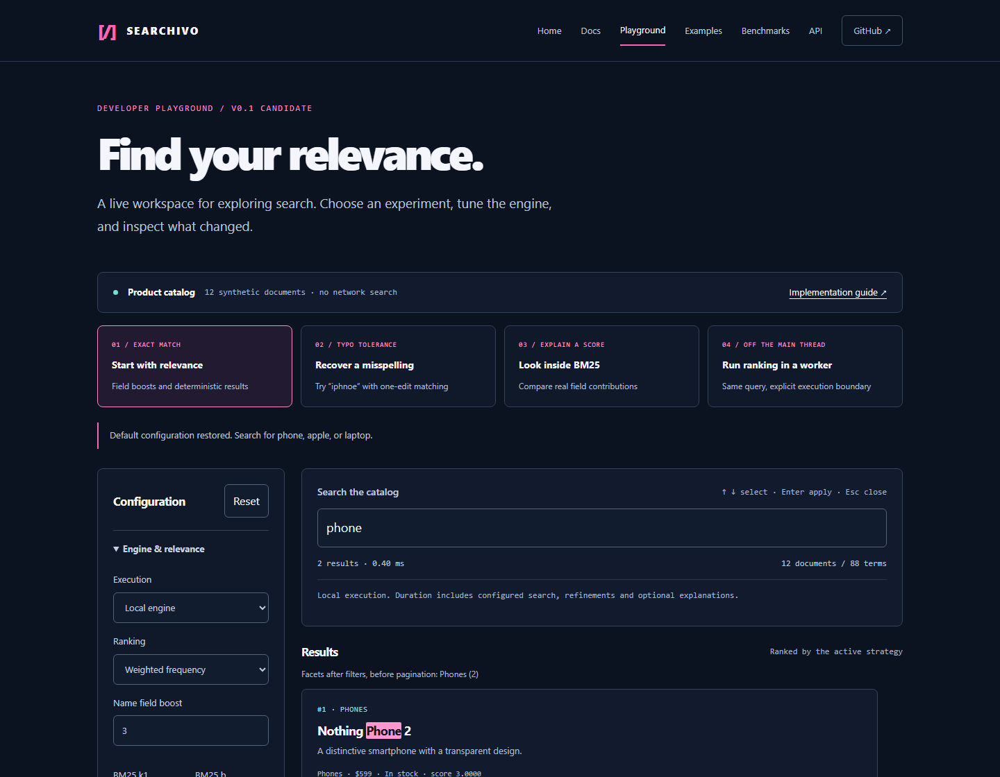
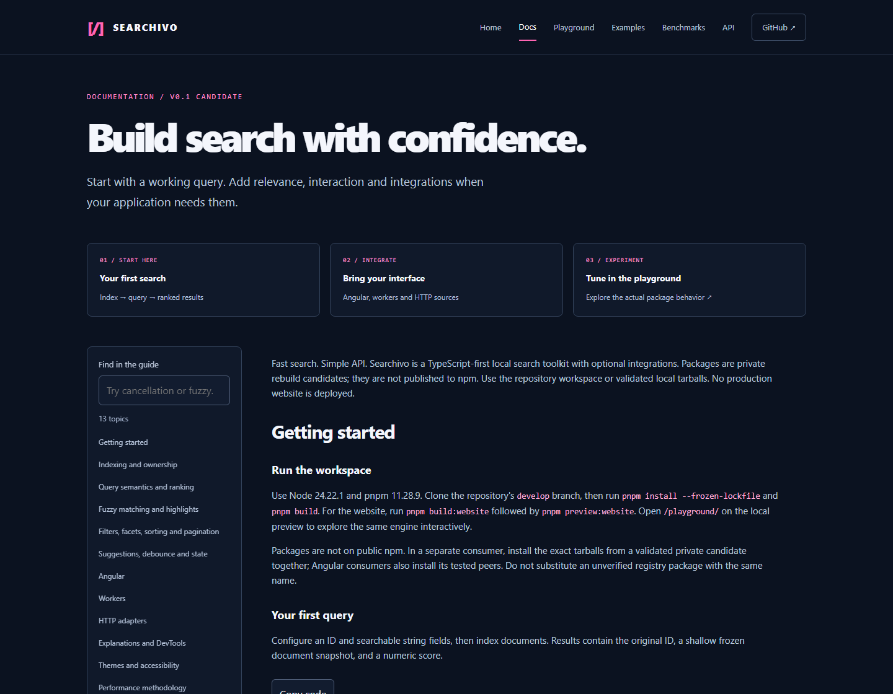

# SEARCHIVO

**Fast search. Simple API.**

A TypeScript-first search toolkit for applications that want control over their data, ranking and interface. Start with a zero-dependency local engine. Add Angular, workers, HTTP sources or diagnostics through explicit imports.

[](https://github.com/yovi-labs/searchivo/actions/workflows/ci.yml)
[](LICENSE)
[](CHANGELOG.md)

[Documentation](docs/README.md) · [Playground](apps/playground/README.md) · [Examples](examples) · [Benchmarks](benchmarks/README.md) · [Contributing](CONTRIBUTING.md)



## Why Searchivo?

- **Own the index.** Typed documents, incremental mutations and deterministic results, without a hosted search service.
- **Control relevance.** Field boosts, optional BM25 and bounded one-edit fuzzy matching. Inspect actual score contributions when needed.
- **Build your interface.** Structured highlights, suggestions, refinements and cancellable state. Angular adds scoped providers, Signals and a native input directive.
- **Pay for what you import.** Core has zero runtime dependencies. Workers, HTTP adapters, diagnostics and themes are optional.

## Live Angular demo

[**Open the live Angular demo →**](https://searchivo.netlify.app/)

- [10,000-product catalog](https://searchivo.netlify.app/#catalog): fictional retail data with real Searchivo BM25 search, typo recovery, filters, sorting and pagination.
- [Feature lab](https://searchivo.netlify.app/#features): Angular Signals, IME, mutations, workers, working HTTP fixtures, cancellation and diagnostics.
- [Developer documentation](https://searchivo.netlify.app/docs/): tutorials, concepts, recipes and the complete API reference.

[Angular example source](apps/angular-example/src) · [Deployment arrangement](docs/deployment.md). One Netlify project serves the actual Angular application at the root and documentation under /docs/.

## Try the playground

Requires Node **24.22.1** and pnpm **11.28.9**.

```sh
 git clone --branch develop https://github.com/yovi-labs/searchivo.git
 cd searchivo
 pnpm install --frozen-lockfile
 pnpm build
 pnpm build:website
 pnpm preview:website
```

Open [the playground](http://127.0.0.1:4174/playground/) or [documentation](http://127.0.0.1:4174/docs/) while the preview is running. These URLs preview the same source as the public deployment. The preview serves a production build, so rebuild after edits.

Explore exact matching, typo recovery, BM25 explanations and real worker ranking. Adjust filters, compare scores, inspect query tokens, view the dataset and copy the engine configuration. [Read the playground walkthrough →](apps/playground/README.md)

## Your first search

Packages are **private and unpublished**. Use the workspace, or install the exact validated tarballs from a private candidate bundle. The package names below describe those local packages, not a public npm installation.

```ts
import { createSearchEngine } from "@searchivo/core";

type Product = { id: number; name: string; description: string };
const search = createSearchEngine<Product>({
  id: "id",
  fields: { name: { boost: 3 }, description: {} },
});
search.add([
  { id: 1, name: "Apple iPhone 15 Pro", description: "Premium smartphone" },
]);
const results = search.search("iphone");
// [{ id: 1, document: ..., score: 3 }]
```

This snippet compiles and executes against the installed tarball in CI. See the [complete executable example](examples/core.ts) for BM25, fuzzy matching, filters, suggestions, state and explanations.

## Find the right package

| Package               | Responsibility                                                                     | Documentation                                                                       |
| --------------------- | ---------------------------------------------------------------------------------- | ----------------------------------------------------------------------------------- |
| `@searchivo/core`     | Inverted index, mutations and relevance; optional entry points for advanced search | [Core](packages/core/README.md) · [Guide](docs/guide.md)                            |
| `@searchivo/angular`  | Scoped providers, readonly Signals and native input enhancement                    | [Angular](packages/angular/README.md) · [Example](apps/angular-example/src/main.ts) |
| `@searchivo/workers`  | Validated client/runtime protocol and transport ownership                          | [Workers](packages/workers/README.md)                                               |
| `@searchivo/adapters` | Validated HTTP source, cancellation and timeouts                                   | [Adapters](packages/adapters/README.md)                                             |
| `@searchivo/devtools` | Bounded local search-state recording                                               | [DevTools](packages/devtools/README.md)                                             |
| `@searchivo/themes`   | Optional scoped CSS and Sass tokens                                                | [Themes](packages/themes/README.md)                                                 |

Core never imports Angular, RxJS, DOM or Node ambient types. [Architecture decisions →](docs/adr)

## Documentation that follows your task



- [Start indexing](docs/guide.md#indexing-and-ownership): IDs, duplicate handling, snapshots and atomic mutations.
- [Tune relevance](docs/guide.md#query-semantics-and-ranking): query semantics, boosts and BM25.
- [Build the results experience](docs/guide.md#filters-facets-sorting-and-pagination): filters, facets, stable sorting and pagination.
- [Handle user input](docs/guide.md#suggestions-debounce-and-state): autocomplete, debounce and cancellation.
- [Integrate Angular](packages/angular/README.md): `createSearchivo(source)`, scoped providers and `<input searchivo>`.
- [Understand execution](docs/guide.md#workers): local, worker and HTTP boundaries.

The website renders the [versioned learning library](docs/README.md) and generated declarations for every public package entry point. Markdown remains the documentation source of truth; complete TypeScript examples compile against packed packages, including Angular strict AOT.

## Quality and performance

The [quality workflow](.github/workflows/ci.yml) enforces formatting, lint, strict types, per-file **100% library coverage** across four metrics, package boundaries, installed-tarball consumers, executable documentation, bundle budgets, website links, browser behavior, accessibility checks and dependency audit.

The recorded basic core consumer is **2,564 bytes raw / 1,248 gzip / 1,111 Brotli**, below the unchanged 5,000-byte gzip budget. Optional features are excluded from that consumer. These figures describe that measured entry point, not every application bundle. [Bundle evidence](docs/optional-bundle-measurements.json) · [Verification scope](docs/verification-candidate.md)

Seeded **1k / 10k / 100k** benchmarks cover repeated vocabulary, high-cardinality dictionaries and worker communication. Reports retain raw samples, environment and source revision. They are synthetic measurements, not production latency guarantees. [Methodology and reports →](benchmarks/README.md)

## Contribute

Explore every package in the [Angular feature lab](apps/angular-example/README.md): build with `pnpm build:example`, run `node scripts/serve.mjs`, then open [the local app](http://127.0.0.1:4173/#features).

Manually test Searchivo in a shopping-style Angular app with [10,000 fictional products](https://searchivo.netlify.app/#catalog), live search, typo recovery, filters, sorting and pagination. It runs on the same preview server. [Catalog details](apps/angular-example/README.md).

```sh
pnpm check
pnpm build:deploy
pnpm exec playwright install chromium
pnpm test:browser
```

Start with [CONTRIBUTING.md](CONTRIBUTING.md). Use the issue templates for bugs and proposals, and the pull-request checklist for behavior changes. See [SECURITY.md](SECURITY.md) for confidential reporting guidance.

## Status and compatibility

This is a new implementation, not recovered historical source. The synchronized `0.1.0-rebuild.0` candidate is pre-1.0, MIT licensed and unpublished. Tested compatibility: Node 24.22.1, TypeScript 6.0.3, Angular 22.2.3 and Playwright Chromium. Other combinations are unverified.

Known limits: snapshots are shallow; tokenization has no stemming; fuzzy expansion can truncate; filtering follows ranking; worker cancellation abandons replies rather than interrupting CPU work. The playground keeps fuzzy expansion, refinements and explanations local in worker mode. The guide documents these contracts explicitly.

[Changelog](CHANGELOG.md) · [Private candidate preparation](docs/adr/0012-release-policy.md) · [Project tracker](https://app.notion.com/p/3f216fa3a42381689ffbd9169bea07ae)

Public npm publication, public releases and merging to `main` require separate approval. Previously prepared candidate manifests remain tied to their recorded revisions; later documentation changes do not silently replace those artifacts.
