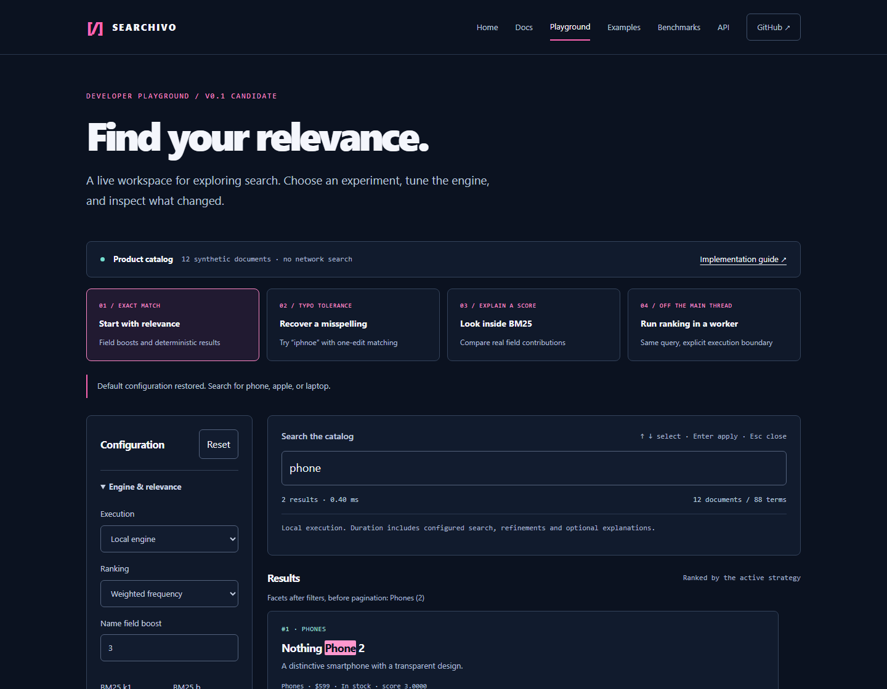

# Searchivo developer playground

A working catalog-search laboratory built from the real core and worker packages. No hosted search service, API key or remote dataset is required.



## Run locally

From the repository root:

```sh
pnpm install --frozen-lockfile
pnpm build
pnpm build:website
pnpm preview:website
```

Open [the local playground](http://127.0.0.1:4174/playground/). Rebuild after source changes; this preview server serves the production build.

## Four experiments

| Experiment      | What to change                                | What to observe                                         |
| --------------- | --------------------------------------------- | ------------------------------------------------------- |
| Exact match     | Search `phone`; adjust the name boost         | Deterministic scores from weighted field frequency      |
| Typo tolerance  | Search `iphnoe`; toggle fuzzy matching        | The inspector shows expansion to `iphone`               |
| Explain a score | Select BM25 with `apple`; enable explanations | Per-field contributions before filtering/pagination     |
| Worker ranking  | Run `laptop` in a Web Worker                  | Real protocol round trip with the same ranking contract |

Each experiment starts from the defaults. Reset restores all controls and the `phone` query. Copy configuration copies the local engine snippet; it does not export filters or worker orchestration. The inspector also exposes normalized query tokens and the complete synthetic dataset.

## Keyboard and accessibility

Type in the search field to request suggestions. Use Up/Down to select, Enter to apply and Escape to close. Controls have visible labels, focus styles and browser validation. IME composition is preserved. Native disclosure sections organize controls and diagnostics. Automated browser and axe checks cover the included interface; consumers remain responsible for their own accessibility.

## Execution boundaries

The 12 product documents are synthetic fixtures with illustrative prices. They demonstrate behavior, not throughput. In worker mode, ranking executes inside a module Worker; fuzzy expansion, refinements and optional explanations remain local. Duration includes the selected pipeline and optional instrumentation. Cancellation abandons replies rather than interrupting synchronous work.

See [the guide](../../docs/guide.md), [fixtures](../website/src/fixtures.ts), [mount lifecycle](src/index.ts), and [independent benchmarks](../../benchmarks/README.md).
